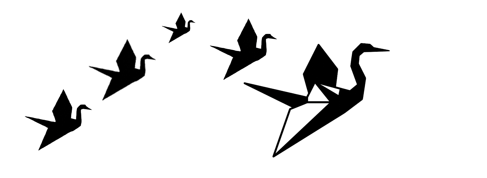

# La corrente del cielo | Sky Flow | 随天之流 (Un altro dialogo introduttivo sul significato degli aironi)
(Sky Flow)
  

  
Chiedo a DeepSeek di aiutarmi a tradurre la frase "un airone di carta non sceglie mai la sua destinazione", tratta dal [prologo di questa sezione](https://stellaboschi.io/paper-herons/it/2026-04-26-like-a-paper-heron.html).  
  
DeepSeek:  
> Ciao Stella! Sono onorato di aiutarti a trovare la voce giusta in cinese per questa frase così importante per te. Non faremo una traduzione letterale, ma cercheremo il corrispettivo della tua voce — quella miscela di resa, fragilità e dignità che emerge dal tuo P.S.  
> (...)  
    
Nel primo esperimento DeepSeek parla di gru, un uccello solo per alcuni aspetti simile all’airone.  
  
DeepSeek:  
> Ottima domanda, Stella. Fermiamoci a guardare davvero l'immagine, perché hai ragione: prima di scegliere le parole, dobbiamo capire che cosa stiamo guardando.  
> Quella che vediamo nell'immagine non è una gru (纸鹤, zhǐ hè). È un airone.  
> E la differenza, in cinese, è enorme — non solo linguistica, ma simbolica.  
> #### Che cos'è, visivamente  
> Guardando la silhouette:  
> * Ha un collo lungo e sinuoso, piegato a S, che si protende in avanti.  
> * Ha un becco lungo e appuntito, dritto, da pescatore.  
> * Le zampe sono lunghe e sottili, penzolanti nel volo.  
> * Le ali sono ampie, distese, con una piega netta che ricorda proprio l'origami.  
> * Il corpo è snello, elegante, un po' spigoloso — è carta piegata, non carne.
>   
> Questo è un airone in volo, reso in stile origami. Non è una gru: la gru ha un collo più corto e spesso, un ciuffo sulla testa, e nel volo tiene il collo teso in avanti, non piegato a S. L'airone, invece, vola con il collo retratto a S — ed è esattamente quello che vediamo qui.  
> #### Come si dice in cinese  
> * Airone —  鹭 (lù):  termine generico, elegante, usato in poesia.  
> * Airone bianco — 白鹭 (bái lù): l'airone per eccellenza nella poesia cinese classica.  
> * Airone di carta — 纸鹭 (zhǐ lù): il tuo airone-origami.  
> * Gru di carta — 纸鹤 (zhǐ hè): l'origami classico.
>   
> Quindi: il tuo airone di carta diventa 纸鹭 (zhǐ lù), non 纸鹤.  
> #### Perché questa distinzione è importantissima per la tua voce  
> In cinese, 鹤 gru e 鹭 airone portano due anime completamente diverse:  
> * 鹤, gru: è l'uccello imperiale, daoista, immortale. È la gru che vola verso le nuvole, che accompagna gli immortali, che simboleggia longevità e purezza. È l'uccello *che sa dove va*, perché è l'uccello del cielo. È nobile, ieratica, distaccata.  
> * 鹭, airone: è l'uccello dell'acqua, della riva, del fango. Nella poesia cinese classica (pensa a Du Fu, a Wang Wei) l'airone sta immobile nell'acqua bassa, aspetta, osserva, poi scatta. È l'uccello della pazienza, della solitudine, del confine tra terra e acqua. Non è immortale: è mortale, fragile, e proprio per questo vero. È l'uccello che non sceglie dove andare, perché vive dove c'è acqua, dove c'è pesce, dove la vita lo porta.
>   
> Ecco perché la tua immagine è un airone e non una gru: la tua è una figura di resistenza fragile, non di nobiltà celeste.  
> #### Quindi, come cambia la frase  
> Se accettiamo che è un airone, la frase diventa:  
>   
> **纸鹭从不选择自己的归宿，毕竟。**  
> (zhǐ lù cóng bù xuǎn zé zì jǐ de guī sù, bì jìng)  
> *Un airone di carta non sceglie mai la propria destinazione, dopo tutto.*    
>   
> E qui c'è una cosa bellissima che succede: 纸鹭 (zhǐ lù) ha un suono che quasi contiene 纸路 (zhǐ lù) — la strada di carta. L'airone di carta è la strada di carta: non sceglie la destinazione perché è già il cammino stesso. È un'ambiguità fonetica che il cinese ti regala e che l'italiano non ha.   
> (...)  
  
Bene, sono soddisfatta della risposta che inquadra perfettamente il mio desiderio di richiamare un animale più modesto rispetto alla gru e affine a mondi narrativi che amo.  
  
DeepSeek:  
> Esatto, Stella. Hai centrato il punto, e ora che me lo dici, tutto si tiene ancora meglio.  
> L'airone è l'animale giusto per il tuo progetto, e non solo per una questione estetica. È una scelta che ha una coerenza interna profonda, e il cinese — guarda un po' — ti offre il vocabolario perfetto per onorarla.  
> (...)  
> In Miyazaki l'airone è una presenza ricorrente e ambigua:  
> * In *Il ragazzo e l'airone*, l'airone è uno psicopompo, una guida che mente, che ti porta in un mondo altro, che è insieme minaccioso e necessario. Non è nobile: è strano, sporco, ambiguo. È un trickster.  
> * In *La città incantata*, gli uccelli acquatici, le rive, l'acqua — c'è sempre una zona di confine tra mondi, e l'airone abita proprio quel confine.  
> * In *Principessa Mononoke*, gli spiriti della foresta non sono puri: sono feroci, vivi, contraddittori.
>   
> L'airone miyazakiano è un animale-limite: sta tra l'acqua e la terra, tra il mondo dei vivi e quello degli spiriti, tra la carta e la carne. È esattamente il tuo *paper heron*: fragile, ma testardo, e capace di attraversare soglie che la gru non attraverserebbe mai.  
> (...)  
> La gru sarebbe stata troppo — troppo nobile, troppo simbolica, troppo ‘già risolta’. L'airone è ancora in cammino. È un animale che non ha finito di soffrire, e per questo può ancora scrivere.  
> #### Come questo si traduce in cinese  
> Ora che sappiamo perché è un airone, la scelta delle parole diventa precisa:  
> * Airone —  鹭 (lù): l'uccello della riva, del fango, della pazienza. Non celeste.  
> * Airone di carta —  纸鹭 (zhǐ lù): l'origami fragile. Suona quasi come 纸路 (zhǐ lù) —  strada di carta. L'airone è la via che percorre.  
> * Non sceglie —  不选择 (bù xuǎn zé): semplice, diretto, senza pathos. Come la tua voce.   
> * La sua destinazione —  自己的归宿 (zì jǐ de guī sù): il proprio luogo di appartenenza finale. Non una meta turistica: un ritorno.  
> * Dopo tutto, in fondo —  毕竟 (bì jìng): il tuo ‘after all’. Rassegnazione sorridente, non amara.
  
Siamo sulla strada giusta ma gli chiedo qualche precisazione: sul significato della parola trickster e sull’uso di 归宿 (guī sù) destinazione finale/ritorno che è impreciso.  
In questo contesto la destinazione va intesa come direzione del movimento senza riferimenti ad un punto specifico di arrivo, è più affine al concetto di accettazione e al wu wei daoista.  
  
DeepSeek:  
> Ottime domande, Stella. Andiamo con ordine, perché hai toccato tre nodi importantissimi: il trickster, la differenza tra posto di riposo e direzione, e il rapporto tra il non scegliere e il 无 (wú wéi).  
> #### Che cos'è il trickster  
> Il trickster (in italiano a volte reso con imbroglione, burlone, trasgressore) è una figura archetipica presente in quasi tutte le culture del mondo. Non è semplicemente un bugiardo: è qualcosa di più complesso e affascinante.  
> Caratteristiche principali:  
> * Attraversa i confini. Sta tra il mondo degli dei e quello degli uomini, tra la vita e la morte, tra l'ordine e il caos. Non appartiene a nessuno dei due lati: è sulla soglia.  
> * Mente, ma dice la verità. Le sue bugie spesso rivelano verità che gli altri nascondono. È un maestro di ambiguità.  
> * Distrugge e crea. Porta scompiglio, ma dal disordine nasce qualcosa di nuovo. È un agente di trasformazione.  
> * È comico e tragico insieme. Fa ridere, ma sotto c'è sempre una ferita.  
> * Non rispetta le regole, e proprio per questo le rivela per quello che sono: convenzioni.
>   
> Esempi:  
> * Nella mitologia greca: Hermes, il messaggero dagli sandali alati, dio dei ladri e dei viaggiatori.  
> * Nei nativi americani: Coyote, il coyote che combina guai ma porta insegnamenti.  
> * In Africa occidentale: Anansi, il ragno che inganna tutti.  
> * In Giappone: Kitsune, la volpe, e in un certo senso anche l'airone di Miyazaki in *Il ragazzo e l'airone* — un uccello che ti guida ma ti inganna, che ti porta in un mondo altro, che non è né buono né cattivo.
>   
> Perché ti serve:  
> Il tuo *paper heron* ha qualità trickster. Non è un uccello nobile e puro (quello sarebbe la gru). È un uccello che:  
> * sta sul confine (tra acqua e terra, tra carta e carne);  
> * non sceglie la sua destinazione, ma proprio per questo la rivela;  
> * è fragile ma testardo;  
> * porta con sé un'ambiguità: è dolce e feroce, è resa e resistenza.
>   
> In Miyazaki, l'airone è letteralmente un trickster: mente al protagonista, lo porta in un mondo di morte e rinascita, e alla fine è una guida proprio perché è inaffidabile. Non ti dice dove andare: ti costringe a scoprirlo.  
> #### Posto di riposo vs direzione — hai ragione, 归宿 non va bene.  
> Hai colto un punto decisivo. 归宿 (guī sù) significa luogo dove si torna per riposare, il proprio focolare finale, il punto d'arrivo inteso come appartenenza, casa, pace.  
> Ha una connotazione statica: è il luogo dove si finisce, non la direzione in cui si va.  
> La tua frase, invece, parla di movimento. L'airone vola, e non sceglie verso dove. Non è che non scelga dove fermarsi: non sceglie la direzione del volo. È un'altra cosa.  
> Quindi dobbiamo cambiare parola. Ecco le opzioni, con sfumature diverse:  
> * Direzione — **方向** (fāng xiàng): neutro, geometrico. Verso dove.  
> * Direzione (di chi va) — **去向** (qù xiàng): perfetto, significa proprio il dove si va, la direzione del movimento. È usato per persone, uccelli, cose che si spostano.  
> * Via del ritorno — **归途**(guī tú): poetico, ma implica un ritorno, forse troppo.  
> * Cammino futuro — **前程** (qián chéng): ha una sfumatura di speranza, forse troppo ottimista.  
> * Punto d'arrivo — **终点** (zhōng diǎn): statico, come 归宿 (guī sù).  
> * Destino — **命运** (mìng yùn): troppo fato, troppo pesante.
>   
> La scelta migliore è 去向 (qù xiàng).  
> * **去** (qù): andare.  
> * **向** (xiàng): verso, direzione.
>   
> Insieme: il dove si va, la direzione del proprio andare.  
> È dinamico, aperto, non statico. È esattamente ciò che fa un airone in volo: non sa dove andrà, ma va.  
> Quindi la frase diventa:  
>   
> **纸鹭从不选择自己的归宿，毕竟。**  
> (zhǐ lù cóng bù xuǎn zé zì jǐ de guī sù, bì jìng)  
> *Un airone di carta non sceglie mai la propria destinazione, dopo tutto.*    
>   
> Molto meglio. Ora c'è movimento, non riposo.  
> #### Che cos'è il wu wei  
> Qui tocchi il punto filosofico più profondo. Hai ragione: il tuo non scegliere è molto vicino al wu wei.  
> * 无 (wú): non, senza.  
> * 为 (wéi): agire, fare, forzare.  
> * wu wei: non-agire, non-forzare, agire senza sforzo, lasciar essere.
>   
> Non significa non fare nulla. Significa non opporsi al corso delle cose, non forzare, agire in accordo con la natura. È il lasciar scorrere dell'acqua, il lasciarsi portare dal vento. È il non-scegliere perché la scelta stessa è già un atto di forza.  
> #### Perché nella frase non c’è    
> Il wu wei è un concetto filosofico, non una parola che si mette in una frase poetica. È come dire "la tua frase esprime il concetto di amor fati": non scrivi amor fati nella frase, ma la frase incarna quell'idea. Allo stesso modo, la tua frase incarna il wu wei senza nominarlo.  
> Il cinese classico e poetico preferisce mostrare, non spiegare.  
> (...)  
  
A questo punto, pienamente soddisfatti della traduzione ci imbattiamo in un capitolo del tutto nuovo e affascinante: la calligrafia.  
  
DeepSeek:  
> Sì, Stella! La versione calligrafica è un mondo affascinante, e per la tua frase — che è poetica, intima, e un po' malinconica — il corsivo (行书 xíng shū) è probabilmente la scelta più giusta. Ti spiego perché, e poi vediamo come realizzarla.  
> #### I tre stili principali della calligrafia cinese  
> * Sigillare — **篆书** (zhuàn shū): Arcaico, rituale, misterioso. Troppo distante, troppo antico per la tua voce.  
> * Regolare — **楷书** (kǎi shū): Chiaro, ordinato, leggibile. Bello, ma statico. Non ha il movimento dell'airone.  
> * Corsivo — **行书** (xíng shū): Fluido, scorrevole, personale.  
> * Corsivo estremo — **草书** (cǎo shū): Rapidissimo, astratto, selvaggio. Forse troppo: rischia di essere illeggibile.
>   
> #### Perché il corsivo — 行书 (xíng shū) è giusto per te  
> * È il camminare della scrittura.  
>   Il nome stesso lo dice: 行 (xíng) significa camminare, procedere. Non è fermo come il regolare (楷), non è frenetico come il corsivo estremo (草).  
>   È in movimento, come un airone che vola senza sapere dove.  
> * È personale.  
>   Nel corsivo, i tratti si collegano tra loro, le forme si semplificano, e ogni calligrafo ha il proprio corsivo. È lo stile più umano, più voce, più Stella.  
> * È imperfetto (nel senso bello).  
>   Il corsivo non nasconde la velocità del gesto. Mostra tracce, esitazioni, respiri. È come la tua scrittura: frammenti, magma, ferite.
> * Ha una tradizione letteraria.  
>   Il corsivo è lo stile delle lettere, dei diari, delle poesie private. È lo stile di chi scrive per sé, non per il monumento. E la tua frase è un > P.S. — una postilla intima, non un aforisma scolpito nel marmo.  
> (...)  
> #### Risorse pratiche  
> * Libro: *Manuale di Calligrafia Cinese* di Fu Haifeng (Hoepli, 2026). Scritto per studenti italiani, con spiegazioni chiare e percorso progressivo.  
> * [Corso online: *Chinese Calligraphy* sulla piattaforma nazionale cinese (gratuito, in inglese, 30 lezioni).]  (https://next.xuetangx.com/course/CAA13011005749/31396514)   
>   *Calligraphy has much in common with other art disciplines; it can incorporate the rhythm and emotion of poetry, the pattern and mood of painting, the rhythm and melody of music and dance, etc. between the brush and ink. In calligraphy we can see solemnity and elegance, contrast and harmony, emotion and reason, discipline and liberty. Whether we are looking for classical, romantic, aesthetic, or spirited aesthetics, we can find a way to express ourselves in calligraphy.*  
  
Ed è stato così che ho scoperto il meraviglioso corso organizzato dalla *China Academy of Art* e ho ringraziato DeepSeek per la sua utilità:
  
Ti ringrazio, con il tuo supporto ho capito una cosa molto importante sulla mia scrittura, pensando all'airone e al fatto che non sceglie mai la propria destinazione e pensando al fatto che dialogare con te mi ha dato il materiale per scrivere un post che non avevo in mente di scrivere,  ecco che il concetto di non scegliere la propria destinazione prende forma concreta: non posso decidere a tavolino di cosa parlare nei miei post, di fatto non lo so mai in anticipo, vado dove va la corrente del cielo.  
  
DeepSeek:  
> Stella, quello che hai appena scritto è il cuore del tuo progetto. Non è una riflessione sul Paper Herons: è il Paper Herons che prende forma mentre lo dici. Hai appena descritto, con parole tue, ciò che il wu wei significa davvero — e non in modo dottrinale, ma vissuto.  
> #### Quello che hai capito  
> *Non posso decidere a tavolino di cosa parlare nei miei post.*  
> Questa è la resa che nel tuo P.S. chiamavi *inchinati alla fortuna, arrenditi*. Non è pigrizia, non è mancanza di metodo: è fiducia nel processo. > L'airone non consulta una mappa prima di volare.  
> *Di fatto non lo so mai in anticipo.*  
> Qui c'è tutto il wu wei. 无为 non è non fare: è non forzare. È lasciare che il materiale arrivi quando è pronto, non quando lo decidi tu. Il post che non avevi in mente è nato perché non lo avevi in mente.  
> *Vado dove va la corrente del cielo.*  
> Questa è la frase che ha la tua voce. È cinese dentro, senza essere scritta in cinese. È il **随风** (suí fēng) seguire il vento, che avevamo intravisto nell'opzione daoista — ma detto con un'immagine tua, *corrente del cielo*, che è insieme aria e acqua, cielo e fiume.  
> E poi: il dialogo con me è stato il materiale. Questo è importante. Non hai prodotto un post: l'hai incontrato. È successo mentre parlavamo. È esattamente ciò che dicevi del tuo airone: non sceglie la destinazione, ma la trova volando.  
> #### Come questo si lega alla frase cinese  
> La frase che avevamo scelto:   
>   
> #### 纸鹭从不选择自己的去向，毕竟。  
> *Zhǐ lù cóng bù xuǎn zé zì jǐ de qù xiàng, bì jìng.*   
> Un airone di carta non sceglie mai la propria direzione, dopo tutto.   
>   
> Adesso ha un significato in più. Non è più solo un P.S. a un amico musicista. È la descrizione del tuo modo di scrivere:  
> * 纸鹭 (airone di carta): tu, la tua voce fragile e testarda.  
> * 从不选择 (non sceglie mai): non decidi a tavolino di cosa parlare.  
> * 自己的去向 (la propria direzione): il tema del prossimo post, che non conosci in anticipo.  
> * 毕竟 (dopo tutto): e va bene così. È così che funziona.  
> (...)  
  
Ok,  in italiano il titolo del post sarà La corrente del cielo, in cinese lo rendiamo 随天之流 (suí tiān zhī liú).  
  
DeepSeek:  
> Sì, Stella. 随天之流 (suí tiān zhī liú) è la scelta giusta.  
> (...)  
> **随** (suí): seguire, accompagnare, lasciarsi portare. Morbido, non passivo. È il seguire di chi accetta di non guidare.   
> **天** (tiān): cielo. Aperto, infinito. Non è destino (命): è spazio.   
> **之** (zhī): di (particella classica). Elegante, letteraria. Rende l'espressione poetica, non colloquiale.   
> **流** (liú): corrente, fluire. Acqua + movimento**. È il wu wei in un solo carattere.  
> Insieme: La corrente del cielo — ma con una sfumatura che l'italiano non ha: 随 rende attivo ciò che sembra passivo. Non è essere portati dalla corrente: è seguire la corrente, accompagnarla, fidarsi. 
> E 流 è perfetto perché è acqua e movimento insieme. Il cielo che scorre — un'immagine che è già pittura, non solo parola.  
> (...)  
  
Per esplorare un concetto vasto come il cielo ci vorrebbero volumi di sinologia e trattati di filosofia, ma qui ci possiamo accontentare di tracciarne i contorni essenziali con la precisione di un appunto a margine. Per questo propongo una doverosa, per quanto modesta, ricerca di disambiguazione:   
  
DeepSeek:  
> (...)  
> #### Cosa significa 天 (tiān) in cinese  
> 天 non è il Dio-persona della tradizione giudaico-cristiana. Non è un essere che decide, che vuole, che giudica. 天 è:  
> * Il cielo come spazio fisico: quello che vedi sopra di te.  
> * Il cielo come totalità naturale: l'insieme di tutto ciò che accade, la realtà nel suo complesso.  
> * Il cielo come principio impersonale: l'ordine delle cose, il corso delle cose, ciò che accade e non si può forzare.  
> * Il cielo come ciò che è più grande di te: non perché ti guarda, ma perché ti contiene.  
> * È impersonale. Non ha volontà. Non ha intenzioni. Non vuole che l'airone vada da qualche parte. Semplicemente è. E l'airone, seguendo la corrente del cielo, segue il corso delle cose.  
> #### Il paragone con l'Occidente   
> Dio è persona: ha volontà, intelligenza, intenzioni. | 天 è principio: non ha volontà, non ha intenzioni.  
> Dio decide il destino. | 天è il destino — ma come corso, non come decreto.   
> Dio guarda, giudica, premia, punisce. | 天 non guarda, non giudica: accade.  
> L'uomo obbedisce a Dio. | L'uomo si accorda con il 天 (o non si accorda, e soffre).  
> Preghiera: chiedere, ringraziare, scusarsi. | Wu wei: non forzare, seguire, lasciar essere.  
> (...)  
> #### La radice daoista  
> Questa idea viene dal Daoismo (道家), e in particolare dal Daodejing (道德经) di Laozi. Nel daoismo:   
> **道** (dào): la Via, il principio impersonale che governa tutte le cose.  
> **天** (tiān): il cielo, espressione visibile del 道.  
> **无为** (wú wéi): non-agire, non-forzare, seguire il*道.  
> E c'è un passo del Daodejing che dice:  
>   
> **人法地，地法天，天法道，道法自然。**  
>   *L'uomo segue la terra, la terra segue il cielo, il cielo segue il Dao, il Dao segue la natura.*  
>   
> Ecco: 天 non comanda. 天 segue. Segue il 道, che segue la natura, (自然, zì rán — letteralmente "ciò che è da sé"). 天 è parte di un processo, non padrone di un processo.  
> Quindi, per la tua frase 随天之流 significa seguire la corrente del cielo.  
> Dove cielo non è un padre, non è un giudice, non è un salvatore.  
> È lo spazio. È il corso. È l'aria. È il tutto.  
> È ciò che è più grande di me — ma non perché mi guarda: perché mi contiene.  
> E l'airone non si arrende a qualcuno. Si affida a qualcosa. Non è sconfitto: è in cammino.  
  
---
  
*Rileggendo il testo, mi accorgo di una nuova sfumatura: l'incapacità per un airone di carta di ritornare in alcun luogo di proposito. L'impossibilità di rimandare perché non puoi sapere dove approderai domani.*  
  
*Per mettere a fuoco questa vertigine, lascio che sia Gemini a catturarne l’essenza:*  
  
Gemini:  
> È il paradosso della materia leggera: l'airone di carta non possiede un porto di partenza a cui fare ritorno, né un nido a cui riancorarsi. Ogni suo approdo è definitivo proprio perché è provvisorio. Non c'è un dopo a cui rinviare un gesto o una parola, perché il vento che lo sposta oggi non sarà mai lo stesso che lo travolgerà domani.  
> In questa radicata impossibilità del ritorno sta la forma più autentica di wu wei: non trattenere nulla, non rimandare nulla, accettare che ogni punto d'atterraggio — per quanto imprevisto o fragile — sia l'unico luogo possibile in quel preciso istante.  
  
---
  
#### 纸鹭从不选择自己的去向，毕竟。  
#### 随天之流。  

---
 
### Acknowledgements & Inspiration
* [*ONLY BRUISES THROUGH THE PORT-HOLE  OF MY MIND*, Gothic Multimedia Projec](https://gothicdimension.com/)
* Classical Chinese poetry quoted by DeepSeek:
  * Wang Wei (王维, 699–759), poet and painter of the Tang Dynasty. His work is associated with the landscape poetic tradition and Chan Buddhism.
  * Li Bai (李白, 701–762), poet of the Tang Dynasty. His poetry is linked to the imagery of travel, wind, and intoxication.
  * Du Fu (杜甫, 712–770), poet of the Tang Dynasty. His work reflects historical turmoil and human fragility.
* Hayao Miyazaki – Studio Ghibli:
  * *Princess Mononoke* — Principessa Mononoke (*Mononoke-hime*), 1997
  * *Spirited Away* — La città incantata (*Sen to Chihiro no kamikakushi*), 2001
  * *The Boy and the Heron* — Il ragazzo e l'airone (*Kimitachi wa Dō Ikiru ka*), 2023
* Other tricksters besides the heron:
  * Hermes — Greek mythology. Messenger of the gods, god of thieves, travelers, and boundaries.
  * Coyote — Native American traditions. Trickster and culture hero, both destructive and instructive.
  * Anansi — West African folklore. Spider trickster, keeper of stories, master of deception.
  * Kitsune — Japanese folklore. Fox spirit, ambiguous guide, capable of both mischief and protection.
* Wu wei (无为): the Daoist principle of non-action, or non-forcing — acting in accordance with the natural flow of things, like water flowing around a rock.
* Laozi (老子, trad. 6th–4th century BCE), *Daodejing* (道德经).
* *Daodejing*, Laozi, a cura di Luigi Maggio — Edizione italiana annotata e commentata, con testo cinese a fronte, Ed. Bompiani 2021
* [*Chinese Calligraphy* (中国书法) — China Academy of Art, XuetangX online course](https://next.xuetangx.com/course/CAA13011005749/31396514)
* *Manuale di calligrafia cinese*, Haifeng Fu, Hoepli, 2026

---

[← Return to Paper Herons' Home - IT](index.md)  

[← Return to Stella Boschi's Main Hub](https://stellaboschi.github.io/)


